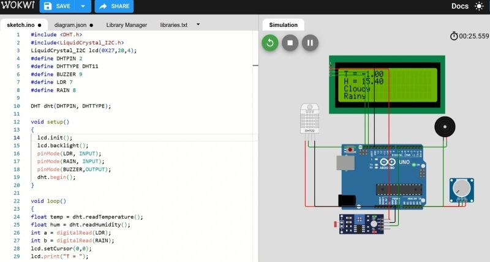

# Real-time-environmental-parameter-monitoring-system-using-IoT-and-sensor-network

A real-time environmental monitoring prototype built during my Embedded Systems and IoT internship at Approtech R&D Solutions.

## Overview
This Arduino-based system measures temperature and humidity and detects light level and rain, then shows the live readings and weather status (Cloudy/Sunny, Rainy/No Rain) on a 20x4 I2C LCD. A buzzer output follows the rain sensor state.

## Circuit Simulation

Circuit simulated in Wokwi.

**Note:** The hardware prototype used a DHT11 sensor. The Wokwi simulation uses a DHT22 as a substitute, since the DHT11 isn't available there.

## Components Used
- Arduino Uno
- DHT11 temperature and humidity sensor
- LDR (light sensor module)
- Rain sensor module
- 20x4 I2C LCD
- Buzzer

## How It Works
1. The DHT11 reads temperature and humidity.
2. The LDR module reports whether it is cloudy or sunny.
3. The rain sensor module reports whether it is raining.
4. The Arduino shows temperature, humidity, light status and rain status on the LCD, refreshing every second.
5. The buzzer output changes with the rain sensor state.

## Libraries Required
- DHT sensor library
- LiquidCrystal_I2C

## Firmware
Arduino firmware written in C/C++, available in this repository as `environmental-monitoring-system.ino`.

## My Role
I built this project during my Embedded Systems and IoT internship at Approtech R&D Solutions and simulated the circuit in Wokwi.
